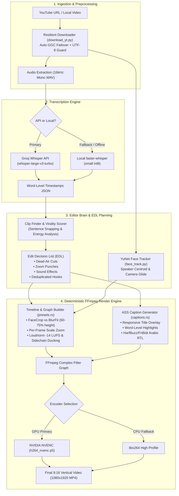

# ⚡ Viral Clipper

<div align="center">


<p align="center">
  <strong>Local-First AI Short-Form Video Editing Studio</strong><br />
  Turn long-form YouTube videos, podcasts, and streams into high-retention 9:16 vertical clips (TikTok, YouTube Shorts, Instagram Reels) with smart face tracking, dynamic word-by-word animated captions, jump cuts, punch-in zooms, and audio mastering — completely free and privacy-focused.
</p>

[Key Features](#-key-features) •
[Architecture](#-architecture) •
[Style Presets](#-built-in-style-presets) •
[Hardware & Requirements](#-hardware--system-requirements) •
[Installation](#-quickstart-guide) •
[Testing & QA](#-verification--quality-assurance)

</div>

---

## 🌟 Visual Showcase

<div align="center">
  
  <p><em>Real Render: 16:9 Landscape YouTube stream reframed to 9:16 Vertical with YuNet Face Tracking, Responsive Title, Kinetic Pop Subtitles, and Dead-Air Trimming.</em></p>
</div>

---

## ✨ Key Features

### 🎯 1. Whole-Video AI Analysis & Virality Scorer
- **Context-Aware Moment Extraction:** Ingests long videos and evaluates speech density, emotional hooks, narrative escalation, and punchlines rather than arbitrary timers.
- **Sentence-Boundary Snapping:** Clips snap cleanly to full grammatical sentences without clipped consonants or amputated context.
- **Honest Feedback Rubric:** Provides realistic virality scores, hook ratings, and constructive editorial reasoning before you render.

### 🎬 2. Autonomous Short-Form Director (Edit Engine V2)
- **Deep Learning Smart Face Tracking:** Powered by OpenCV YuNet ONNX. Detects and tracks speaking faces across landscape sources, centering the action in a 9:16 portrait canvas with dead-zone stabilization and smooth camera glide.
- **Cinematic Designed Background (BlurFit):** For wide footage, multi-speaker setups, or gameplay, scales foreground content to fill **60%–75% of the portrait height** over an ultra-clean Lanczos-filtered blurred backdrop (eliminating the tiny 30% horizontal letterbox strip defect).
- **Dead-Air Silence Trimming:** Intelligently detects and cuts awkward pauses with an **80–120ms safety breathing margin**, keeping pacing brisk while preserving natural speech rhythm.
- **Dynamic Punch-In Zooms:** Mathematic per-frame scale zoom punches (8%–18%) mathematically evaluated for key phrase transitions and dramatic cues.
- **Broadcast Audio Mastering:** High-pass filter (70 Hz), EBU R128 loudness normalization (`-14 LUFS`), automatic background music sidechain ducking, and synchronized sound effects (`whoosh`, `pop`, `ding`, `hit`).

### 💬 3. Kinetic Word-by-Word Animated Captions
- **Zero-Drift Synchronization:** Timeline remapping tracks timestamps across cuts and trims with sub-frame accuracy.
- **Anti-Flicker Chunking:** Natural 2–4 word grouping that prevents 1-word flashes on punctuation.
- **Full RTL Arabic & Multilingual Support:** Correct logical character order preserving complex HarfBuzz and FriBidi shaping with bundled `Tajawal` font (no reversed letters or disjointed ligatures).
- **Responsive Title & Hook Overlay:** Prominent, bold title overlay (8%–12% video width) with multi-line auto-wrapping, drop shadows, and anti-duplication logic that ensures the title never copies the opening speech verbatim.

### 📝 4. Script-to-Video Studio (Faceless Content)
- Produce faceless vertical videos directly from a script: automatic scene breakdown, AI text-to-speech voice generation, stock visual assembly, and synchronized kinetic subtitles.

### ⚡ 5. 100% Free & Local-First (Zero Cost)
- **Budget = $0:** Engineered to operate completely on consumer hardware (tested on Windows 11, ASUS TUF Gaming F15 with RTX 3050 Laptop GPU, 16 GB RAM).
- **No Monthly SaaS Subscriptions:** Uses free API tiers (Google AI Studio Gemini, Groq Whisper) or 100% offline local models (`faster-whisper small` on CPU/CUDA).
- **Hardware Accelerated:** Native NVIDIA NVENC (`h264_nvenc`) encoding renders 1080×1920 30fps videos 1.2×+ faster than real time, with automatic fallback to optimized `libx264`.

---

## 🏗️ Architecture



---

## 🎨 Built-In Style Presets

Viral Clipper ships with 8 professionally tuned design templates:

| Preset ID | Name | Typography | Styling Highlights | Best For |
| :--- | :--- | :--- | :--- | :--- |
| `tiktok` | **Viral Bold** | Poppins ExtraBold | Cyan active word, scale pop-in, 9:16 face crop, progress bar, punch zooms | High-energy TikToks, YouTube Shorts |
| `hormozi` | **Hormozi Style** | Anton | Giant 2-word chunks, electric yellow active word, aggressive punch-ins | Business advice, motivational, podcasts |
| `cinematic` | **Cinematic Story** | Montserrat | Ambient depth blur, dramatic pacing, restrained push-ins, gold accent | Long-form interviews, documentaries |
| `neon_gaming` | **Neon Gaming** | Bebas Neue | Neon green highlights, purple glow outline, gameplay retained | Gaming highlights, esports clips |
| `arabic_classic`| **Arabic Classic** | Tajawal ExtraBold | Native RTL shaping, gold active word, soft contrast dark box | Arabic podcasts, speeches, talks |
| `caption_top` | **Captions Top** | Poppins Bold | Subtitles positioned in upper third; face & action unobstructed | Sports, demonstrations, cooking |
| `split_stack` | **Split Screen** | Poppins Medium | Top speaker, bottom looping background video (subway/gameplay) | Faceless TikTok format, retention loops |
| `minimal` | **Minimal Clean** | Poppins Medium | Crisp white text, subtle shadow, zero distractions | Educational lectures, clean explainers |

---

## 💻 Hardware & System Requirements

Designed specifically to operate reliably on budget gaming laptops without out-of-memory crashes:

| Requirement | Minimum Specification | Recommended Specification |
| :--- | :--- | :--- |
| **Operating System** | Windows 10 / 11 (64-bit) | Windows 11 (64-bit) |
| **Processor** | 4-Core x86_64 CPU (Intel Core i5 / AMD Ryzen 5) | 6-Core+ CPU |
| **Memory (RAM)** | 16 GB RAM *(strict RAM safety watchdog active)* | 16 GB+ RAM |
| **Graphics Card (GPU)** | Intel UHD / Iris Xe (CPU rendering) | NVIDIA GTX 1650 / RTX 3050+ (NVENC acceleration) |
| **Free Storage** | 10 GB free disk space | 25 GB+ SSD storage |

---

## 🚀 Quickstart Guide

### 1. Prerequisites (One-Time Setup)

Open **PowerShell** as Administrator and install the essential toolchain:

```powershell
# 1. Install FFmpeg with full codec/libass support (Required)
winget install Gyan.FFmpeg

# 2. Install Node.js 20+ LTS
winget install OpenJS.NodeJS.LTS

# 3. Install Rust
winget install Rustlang.Rustup

# 4. Install Python 3.12 (Recommended for faster-whisper compatibility)
winget install Python.Python.3.12
```

> [!IMPORTANT]
> Restart your PowerShell terminal after installing the prerequisites so all paths are loaded into `PATH`.

### 2. Clone the Repository

```powershell
git clone https://github.com/alidebbich/ViralClipper.git
cd viral-clipper
```

### 3. Install Python Dependencies

```powershell
pip install -r python/requirements.txt
```

*(Installs `faster-whisper`, `opencv-python-headless` for YuNet face tracking, `yt-dlp`, `psutil`, `numpy`, and `soundfile`)*

### 4. Configure API Keys (Zero Cost)

Copy `.env.example` to `.env` in the project root:

```powershell
Copy-Item .env.example .env
```

Open `.env` and paste your free-tier API keys:

```env
# Required for AI clip finding, virality scoring, and editorial decisions
# Get a free key: https://aistudio.google.com/app/apikey
GEMINI_API_KEY=your_gemini_api_key_here

# (Optional) Cloud Whisper transcription — 15s for a 10min video
# Get a free key: https://console.groq.com/keys
GROQ_API_KEY=your_groq_api_key_here
```

> [!NOTE]
> If `GROQ_API_KEY` is omitted, Viral Clipper automatically falls back to offline local transcription using `faster-whisper small` on CPU/CUDA.

### 5. Launch in Development Mode

```powershell
# Install frontend packages
npm install

# Run desktop application
npm run tauri dev
```

---

## 🧪 Verification & Quality Assurance

Viral Clipper includes a rigorous, multi-layer characterization and regression test suite:

```powershell
# Run all Rust library unit tests (30 tests: timeline, captions, zoom, framing, anti-duplication)
cd src-tauri
cargo test --lib

# Run end-to-end characterization tests (11 tests: dead air padding, remapping, ASS generation)
cargo test --test characterization_tests

# Build frontend and TypeScript verification
cd ..
npm run build
```

---

## 📁 Repository Layout

```
├── assets/
│   ├── fonts/               # Bundled fonts (Anton, Bebas Neue, Poppins, Tajawal)
│   ├── models/              # OpenCV YuNet Face Detection model (.onnx)
│   └── sfx/                 # Bundled transition SFX (ding, hit, pop, whoosh)
├── docs/
│   ├── CLIPPER_TECHNICAL_AUDIT.md       # Full architectural and environment audit
│   ├── CLIPPER_IMPLEMENTATION_PLAN.md   # Feature workstreams and roadmap
│   └── CLIPPER_QA_MATRIX.md             # Test results and render benchmarks
├── python/
│   ├── download_yt.py       # Resilient YouTube downloader with GGC failover
│   ├── face_track.py        # Speaker face tracking & centroid tracking (YuNet)
│   ├── transcribe.py        # Groq API + faster-whisper streaming worker
│   └── requirements.txt     # Python dependencies
├── src/                     # React 19 + TypeScript + Vite UI
│   ├── App.tsx              # Main desktop application shell
│   ├── CreateTab.tsx        # Script-to-video studio
│   └── components/          # Video players, clip cards, EDL previewers
├── src-tauri/               # Tauri 2 (Rust) Backend
│   └── src/
│       ├── pipeline/        # Download, transcribe, analyze, edit, and render orchestration
│       ├── render/          # FFmpeg engine, ASS subtitles, presets, edit plan, NVENC
│       ├── storage/         # SQLite database and migrations
│       └── templates/       # Built-in short-form design templates
└── package.json             # Workspace dependencies & build scripts
```

---

## 🗺️ Roadmap

- [x] Intelligent 9:16 vertical face-tracking with smooth camera glide.
- [x] High-coverage designed background composition (BlurFit filling 60–75% height).
- [x] Anti-duplication hook system and anti-flicker subtitle chunking.
- [x] Native HarfBuzz + FriBidi right-to-left Arabic captioning.
- [x] Resilient YouTube download engine with resilient GGC network failover.
- [ ] Direct one-click publishing and scheduling to TikTok and Instagram Reels.
- [ ] Multi-speaker automated two-box conversation split mode.
- [ ] Local Ollama integration for 100% air-gapped AI editorial scoring.

---

## 📜 License & Credits

Distributed under the **MIT License**.

- **Fonts:** Poppins (SIL OFL), Bebas Neue (SIL OFL), Anton (SIL OFL), Tajawal (SIL OFL).
- **Face Model:** OpenCV Zoo YuNet (Apache 2.0).
- **Engine:** Built with [Tauri](https://tauri.app/), [React](https://react.dev/), [FFmpeg](https://ffmpeg.org/), and [faster-whisper](https://github.com/SYSTRAN/faster-whisper).

<div align="center">
  <sub>Developed by <strong>Ali</strong> • Built with zero budget on open-source foundations.</sub>
</div>
