<div align="center">

# ⚡ Viral Clipper
### *The Autonomous, Local-First AI Short-Form Video Studio*

<p align="center">
  <strong>Transform long-form YouTube videos, podcasts, and streams into high-retention 9:16 vertical clips.</strong><br />
  Automated face tracking • Kinetic word-by-word subtitles • Dead-air trimming • Dynamic punch zooms • Broadcast audio mastering
</p>


<p align="center">
  <a href="#-showcase">Showcase</a> •
  <a href="#-core-features">Features</a> •
  <a href="#-architecture">Architecture</a> •
  <a href="#-style-presets">Style Presets</a> •
  <a href="#-hardware--specs">Hardware Specs</a> •
  <a href="#-quickstart">Quickstart</a> •
  <a href="#-testing--qa">Testing & QA</a>
</p>

---

</div>


<div align="center">

| 🚀 1.2× Real-Time NVENC | 🎯 9:16 Deep Learning Face Crop | ⏱️ Zero-Drift Word Sync | 🛡️ 100% Free & Local-First |
| :---: | :---: | :---: | :---: |
| 1080×1920 @ 30 FPS Hardware Encode | YuNet ONNX Centroid Tracking | Sub-frame Timeline Remapping | Zero Subscription Fees |

</div>

---

## ⚡ Core Features

<table>
<tr>
<td width="50%" valign="top">

### 🧠 Autonomous Creative Director
- **Whole-Video Analysis:** Ingests long videos, evaluating speech density, emotional hooks, and narrative escalation rather than arbitrary time intervals.
- **Sentence-Boundary Snapping:** Automatically detects sentence start and end points—never cuts words in half or leaves amputated thoughts.
- **Honest Feedback Rubric:** Provides realistic virality scores, hook ratings, and actionable critique before rendering.

</td>
<td width="50%" valign="top">

### 👤 Deep Learning Face Tracking
- **YuNet ONNX Centroid Tracking:** Automatically tracks speaker faces across 16:9 frames to compose smooth 9:16 vertical shorts.
- **Camera Glide Stabilization:** Dead-zone smoothing prevents jitter and unnatural micro-movements during natural head motion.
- **Multi-Person Fallback:** Intelligently centers on the primary speaker when multiple subjects appear.

</td>
</tr>
<tr>
<td width="50%" valign="top">

### 💬 Kinetic Karaoke Subtitles
- **Word-Level Sub-Frame Sync:** Subtitles stay perfectly synchronized across jump cuts using deterministic timeline remapping.
- **Phrase-Aware Chunking:** Natural 2–4 word groupings with punctuation anti-flicker protection (no isolated 1-word flashes).
- **Native Arabic RTL Support:** Built-in HarfBuzz and FriBidi shaping with bundled `Tajawal` font—proper ligatures and glyph direction.
- **Responsive Dynamic Titles:** Prominent 8%–12% width title banner with auto-wrapping and anti-duplication protection.

</td>
<td width="50%" valign="top">

### ✂️ Precision Pacing & Edit Engine
- **Dead-Air Silence Trimming:** Detects pauses and awkward silences, inserting an 80–120ms safety margin to preserve speech rhythm.
- **Dynamic Punch-In Zooms:** Evaluates per-frame scale zoom punches (8%–18%) tied to topic shifts and dramatic hooks.
- **Designed Background BlurFit:** For wide shots or gameplay, scales foreground to occupy 60%–75% canvas height with Lanczos-filtered blur.
- **Broadcast Audio Mastering:** High-pass filter (70 Hz), EBU R128 loudness normalization (`-14 LUFS`), and sidechain music ducking.

</td>
</tr>
</table>

---

## 🏗️ Architecture

```mermaid
flowchart LR
    classDef highlight fill:#1f2937,stroke:#3b82f6,stroke-width:2px,color:#fff;
    classDef render fill:#111827,stroke:#10b981,stroke-width:2px,color:#fff;
    
    A["🎥 Source Video<br/>(YouTube URL / Local MP4)"] --> B["📥 Downloader & Ingest<br/>(Resilient GGC Failover)"]
    B --> C["🎙️ Audio Extraction<br/>(16kHz Mono WAV)"]
    C --> D{"Whisper Engine"}
    
    D -->|Cloud Primary| E["⚡ Groq Whisper<br/>(~15s for 10m video)"]
    D -->|Local / Offline| F["💻 faster-whisper<br/>(small int8 CPU/CUDA)"]
    
    E --> G["📝 Word Timestamps JSON"]
    F --> G
    
    G --> H["🧠 Clip Finder & Scorer<br/>(Boundary Snapping & Virality Rating)"]:::highlight
    H --> I["📋 Edit Decision List (EDL)<br/>• Cuts • Zooms • SFX • Hooks"]:::highlight
    
    B --> J["👤 YuNet Face Tracker<br/>(Centroid Tracking & Camera Glide)"]:::highlight
    
    I --> K["🎬 Render Graph Builder<br/>• FaceCrop vs BlurFit (60-75% h)<br/>• EBU R128 Audio Normalization<br/>• Sub-frame ASS Subtitles"]:::render
    J --> K
    
    K --> L{"Hardware Encoder"}
    L -->|NVIDIA GPU| M["🚀 h264_nvenc (Preset P5)"]:::render
    L -->|CPU Fallback| N["⚙️ libx264 High Profile"]:::render
    
    M --> O["📱 Final 9:16 Vertical Video<br/>(1080x1920 MP4)"]:::render
    N --> O
```



---

## 🎨 Built-In Style Presets

Viral Clipper includes 8 built-in design presets:

| Preset | Typography | Highlight Style | Framing Mode | Ideal Use Case |
| :--- | :--- | :--- | :--- | :--- |
| **Viral Bold** | `Poppins ExtraBold` | Cyan Pop-In Text | 9:16 FaceCrop + Progress Bar | High-energy TikToks, Shorts, Reels |
| **Hormozi Style** | `Anton` | Electric Yellow Box | Tight Punch-In Crop | Business advice, podcasts, monologues |
| **Cinematic Story** | `Montserrat` | Warm Gold Accent | Ambient Depth BlurFit | Documentaries, slow-burn narratives |
| **Neon Gaming** | `Bebas Neue` | Neon Green Glow | Gameplay Focused Framing | Twitch clips, esports highlights |
| **Arabic Classic** | `Tajawal ExtraBold` | Gold RTL Word Box | HarfBuzz / FriBidi Shaped | Arabic podcasts, interviews, speeches |
| **Captions Top** | `Poppins Bold` | Upper-Third Subtitles | Unobstructed Lower Third | Cooking, sports, product demos |
| **Split Screen** | `Poppins Medium` | Center Split Subtitles | Speaker Top / B-Roll Bottom | Retention loops, multi-angle reactions |
| **Minimal Clean** | `Poppins Medium` | Monochromatic Shadow | Clean Neutral Framing | Lectures, educational explainers |

---

## 💻 Hardware & System Requirements

Engineered with a memory safety watchdog specifically tuned for consumer laptops (tested on ASUS TUF Gaming F15, RTX 3050 Laptop GPU, 16 GB RAM):

| Component | Minimum Specification | Recommended Specification |
| :--- | :--- | :--- |
| **Operating System** | Windows 10 / 11 (64-bit) | Windows 11 (64-bit) |
| **Processor** | Intel Core i5 / AMD Ryzen 5 (4+ Cores) | Intel Core i7 / AMD Ryzen 7 (6+ Cores) |
| **System Memory** | 16 GB RAM *(strict watchdog active)* | 16 GB+ RAM |
| **Graphics (GPU)** | Intel UHD / Iris Xe *(CPU x264 rendering)* | NVIDIA GTX 1650 / RTX 3050+ *(NVENC acceleration)* |
| **Storage** | 10 GB free disk space | 25 GB+ SSD space |

---

## 🚀 Quickstart

### 1. Install System Prerequisites

Open **PowerShell** as Administrator and run:

```powershell
# 1. Install FFmpeg with full libass and codec libraries
winget install Gyan.FFmpeg

# 2. Install Node.js LTS (v20+)
winget install OpenJS.NodeJS.LTS

# 3. Install Rust
winget install Rustlang.Rustup

# 4. Install Python 3.12 (optimal for faster-whisper)
winget install Python.Python.3.12
```

> [!NOTE]
> Restart your PowerShell terminal after installation so that newly installed tools are available in your `PATH`.

### 2. Clone the Repository

```powershell
git clone https://github.com/alidebbich/ViralClipper.git
cd ViralClipper
```

### 3. Install Python Dependencies

```powershell
pip install -r python/requirements.txt
```

### 4. Configure Free API Keys

Copy the sample environment file:

```powershell
Copy-Item .env.example .env
```

Open `.env` in any text editor and paste your free-tier keys:

```env
# Google AI Studio (Free Tier for AI Clip Selection & EDL)
# https://aistudio.google.com/app/apikey
GEMINI_API_KEY=your_gemini_key_here

# Groq Cloud Console (Optional: Fast 15s Whisper Cloud Transcription)
# https://console.groq.com/keys
GROQ_API_KEY=your_groq_key_here
```

*(If `GROQ_API_KEY` is left blank, the app will automatically transcribe locally using `faster-whisper small` on your CPU/GPU).*

### 5. Launch Application

```powershell
# Install frontend dependencies
npm install

# Run in desktop development mode
npm run tauri dev
```

---

## 🧪 Testing & QA

Viral Clipper includes a deterministic automated test suite:

```powershell
# Run 30 Rust library unit tests (timeline, captions, framing, anti-duplication)
cd src-tauri
cargo test --lib

# Run 11 characterization integration tests (dead-air padding, ASS generation, remapping)
cargo test --test characterization_tests

# Build frontend and verify TypeScript types
cd ..
npm run build
```

---

## 📜 License & Acknowledgments

Distributed under the **MIT License**.

- **Typography:** Fonts bundled under SIL Open Font License (`Poppins`, `Anton`, `Bebas Neue`, `Tajawal`).
- **Face Model:** OpenCV Zoo YuNet (Apache 2.0).
- **Core Stack:** Powered by [Tauri](https://tauri.app/), [React](https://react.dev/), [FFmpeg](https://ffmpeg.org/), and [faster-whisper](https://github.com/SYSTRAN/faster-whisper).

<div align="center">
  <sub>Built with zero budget by <strong>Ali</strong> • Powered by Open-Source.</sub>
</div>
