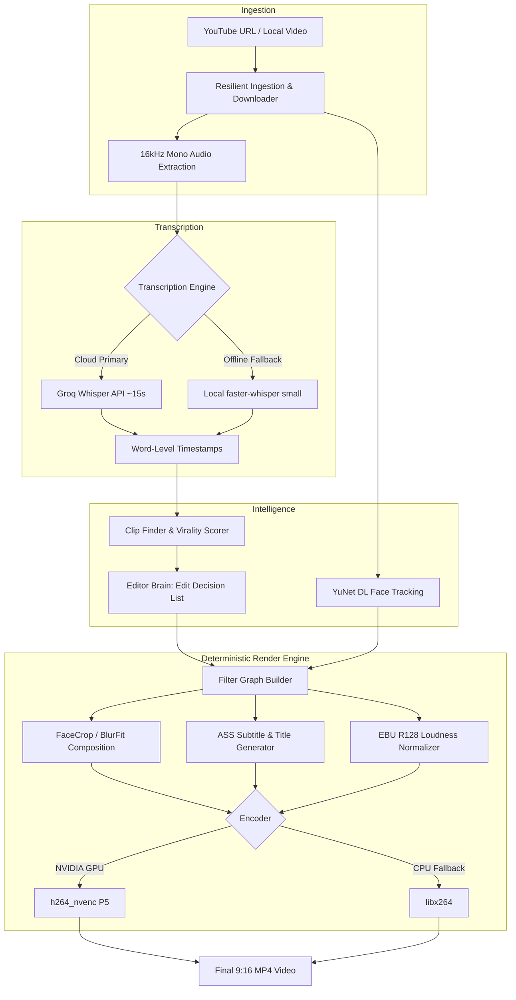

# Viral Clipper

> Local-first desktop studio that analyzes long-form video, finds high-retention moments, and generates edited 9:16 vertical shorts with smart face tracking, dynamic kinetic subtitles, dead-air trimming, and audio mastering.

<p align="center">
  <strong>Transform long-form YouTube videos, podcasts, and streams into high-retention 9:16 vertical clips.</strong><br />
  Automated face tracking • Kinetic word-by-word subtitles • Dead-air trimming • Dynamic punch zooms • Broadcast audio mastering
</p>


<p align="center">
  <a href="#-showcase">Showcase</a> •
  <a href="#-core-features">Features</a> •
  <a href="#-architecture">Architecture</a> •
  <a href="#-style-presets">Style Presets</a> •
  <a href="#-hardware--specs">Hardware Specs</a> •
  <a href="#-quickstart">Quickstart</a> •
  <a href="#-testing--qa">Testing & QA</a>
</p>

---

## Overview


<div align="center">

| 🚀 1.2× Real-Time NVENC | 🎯 9:16 Deep Learning Face Crop | ⏱️ Zero-Drift Word Sync | 🛡️ 100% Free & Local-First |
| :---: | :---: | :---: | :---: |
| 1080×1920 @ 30 FPS Hardware Encode | YuNet ONNX Centroid Tracking | Sub-frame Timeline Remapping | Zero Subscription Fees |

</div>

---

## Pipeline Architecture



---

## Style Presets

| Preset | Typography | Highlight Style | Framing Strategy | Best Suited For |
| :--- | :--- | :--- | :--- | :--- |
| **Viral Bold** | Poppins ExtraBold | Cyan Pop-In Text | 9:16 FaceCrop + Progress Bar | TikTok, YouTube Shorts, Reels |
| **Hormozi Style** | Anton | Electric Yellow Box | Tight Punch-In Crop | Podcasts, business, advice |
| **Cinematic Story** | Montserrat | Warm Gold Accent | Ambient Depth BlurFit | Storytelling, documentaries |
| **Neon Gaming** | Bebas Neue | Neon Green Glow | Gameplay Framing | Stream highlights, gaming clips |
| **Arabic Classic** | Tajawal ExtraBold | Gold RTL Word Box | HarfBuzz / FriBidi Shaped | Arabic podcasts & speeches |
| **Captions Top** | Poppins Bold | Upper-Third Subtitles | Clear Lower Third | Sports, cooking, demos |
| **Split Screen** | Poppins Medium | Center Split Subtitles | Speaker Top / B-Roll Bottom | Retention loops, reactions |
| **Minimal Clean** | Poppins Medium | Monochromatic Shadow | Clean Neutral Framing | Lectures, educational explainers |

---

## Hardware & System Requirements

Viral Clipper includes an active RAM safety watchdog designed to operate reliably on standard laptops without memory exhaustion:

| Component | Minimum | Recommended |
| :--- | :--- | :--- |
| **Operating System** | Windows 10 / 11 (64-bit) | Windows 11 (64-bit) |
| **Processor** | Intel Core i5 / AMD Ryzen 5 | Intel Core i7 / AMD Ryzen 7 |
| **Memory (RAM)** | 16 GB | 16 GB+ |
| **Graphics (GPU)** | Intel UHD / Iris Xe *(CPU rendering)* | NVIDIA GTX 1650 / RTX 3050+ *(NVENC)* |
| **Storage** | 10 GB free space | 25 GB+ SSD space |

---

## Quickstart Guide

### 1. Prerequisites

Install the required build tools and runtimes using Windows Package Manager (`winget`):

```powershell
# FFmpeg with libass and hardware codecs
winget install Gyan.FFmpeg

# Node.js LTS (v20+)
winget install OpenJS.NodeJS.LTS

# Rust toolchain
winget install Rustlang.Rustup

# Python 3.12 (optimal for faster-whisper)
winget install Python.Python.3.12
```

> **Note:** Restart your PowerShell terminal after installation to ensure all binaries are loaded into your `PATH`.

### 2. Clone & Install

```powershell
git clone https://github.com/alidebbich/ViralClipper.git
cd ViralClipper

# Install Python worker dependencies
pip install -r python/requirements.txt

# Install frontend dependencies
npm install
```

### 3. Configure API Keys

Copy the sample environment file:

```powershell
Copy-Item .env.example .env
```

Open `.env` and enter your free API keys:

```env
# Google AI Studio (Free tier for clip analysis & scoring)
# https://aistudio.google.com/app/apikey
GEMINI_API_KEY=your_gemini_api_key_here

# Groq Cloud (Optional: fast 15-second Whisper cloud transcription)
# https://console.groq.com/keys
GROQ_API_KEY=your_groq_api_key_here
```

*Note: If `GROQ_API_KEY` is not set, Viral Clipper will automatically transcribe locally using `faster-whisper small` on your CPU or GPU.*

### 4. Run the Application

```powershell
npm run tauri dev
```

---

## Verification & Testing

The project includes an end-to-end characterization and regression test suite:

```powershell
# Run Rust unit tests (timeline, captions, framing, deduplication)
cd src-tauri
cargo test --lib

# Run integration characterization tests
cargo test --test characterization_tests

# Verify frontend types and build
cd ..
npm run build
```

---

## Repository Structure

```
ViralClipper/
├── assets/
│   └── fonts/               # Bundled fonts (Anton, Bebas Neue, Poppins, Tajawal)
├── python/
│   ├── download_yt.py       # Resilient YouTube downloader with GGC failover
│   ├── face_track.py        # YuNet ONNX face centroid tracking
│   ├── transcribe.py        # Groq API + local faster-whisper streaming worker
│   └── requirements.txt     # Python dependencies
├── src/                     # React 19 + TypeScript frontend
│   ├── App.tsx              # Main desktop application interface
│   ├── CreateTab.tsx        # Script-to-video workflow
│   └── components/          # Video players, clip cards, EDL previewers
├── src-tauri/               # Tauri 2 (Rust) desktop backend
│   └── src/
│       ├── pipeline/        # Ingestion, transcription, analysis, rendering orchestration
│       ├── render/          # FFmpeg engine, ASS generator, presets, NVENC
│       ├── storage/         # SQLite persistence and migrations
│       └── templates/       # Short-form design presets
├── .env.example             # Safe template for environment variables
└── package.json             # Workspace dependencies
```

---

## License

Distributed under the [MIT License](LICENSE). Built by **Ali Debbich**.
